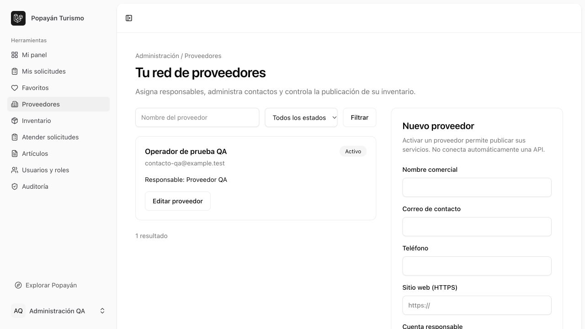
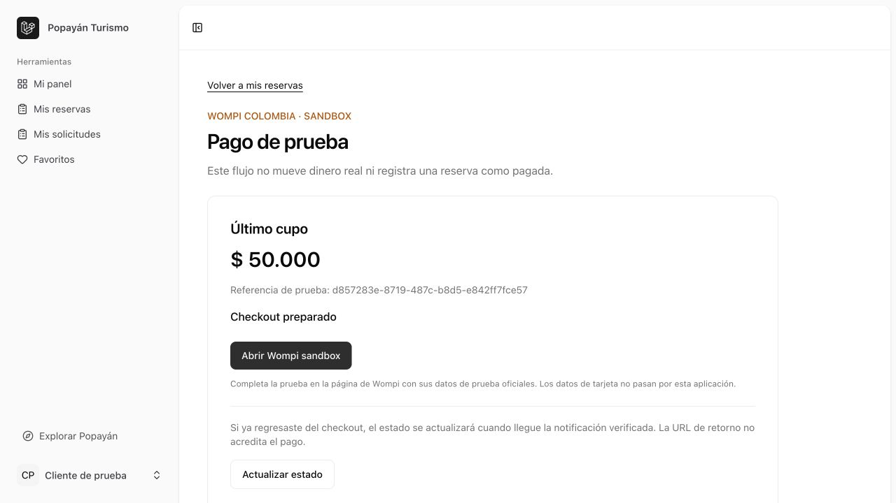
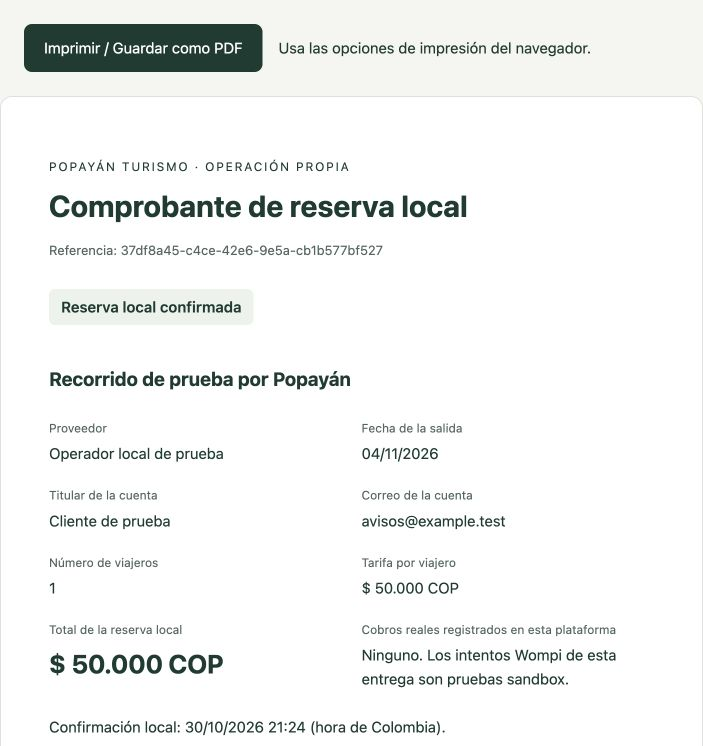

# Popayán Turismo

[](https://github.com/hamstersoftwarecol/AppTuristicaPopayan/actions/workflows/tests.yml)

Plataforma web para gestionar proveedores turísticos, publicar servicios y atender cotizaciones y reservas de actividades y paquetes propios en Popayán, Colombia.

> **Estado:** proyecto en desarrollo. Wompi está implementado exclusivamente en sandbox y desactivado por defecto. Netactica Colombia y Avianca Link están seleccionados, pero sus conectores siguen pendientes. No se procesan cobros reales ni se emiten tiquetes externos.

Plataforma de turismo en desarrollo: Laravel 13, PHP 8.4.1+, Vue 3, Inertia 3, TypeScript, Tailwind 4, Fortify y Spatie Permission 8. Las dependencias de desarrollo actuales requieren PHP 8.4+ y Node 22.18+ (se verificó con PHP 8.4 y Node 24).

## Requisitos

- PHP 8.4.1 o superior compatible con las dependencias del archivo `composer.lock`.
- Composer 2 y Node.js 22.18+ o 24, con npm.
- SQLite para desarrollo; PostgreSQL y Redis son opcionales en local.
- Extensiones PHP requeridas por Composer, incluyendo PDO SQLite para el entorno local y las pruebas.

## Inicio local

```sh
git clone https://github.com/hamstersoftwarecol/AppTuristicaPopayan.git
cd AppTuristicaPopayan
```

La configuración local utiliza SQLite y colas/caché en base de datos para poder ejecutar la aplicación sin servicios externos.

```sh
composer install
cp .env.example .env
php artisan key:generate
```

Crea el archivo SQLite si no existe:

```sh
php -r "file_exists('database/database.sqlite') || touch('database/database.sqlite');"
```

Después ejecuta:

```sh
php artisan migrate --seed
npm ci
npm run build
composer run dev
```

Abre http://localhost:8000. El registro asigna exclusivamente el rol `cliente`. La verificación de correo es obligatoria para entrar al panel. En local, los mensajes de verificación y recuperación se escriben en `storage/logs/laravel.log`; configura SMTP antes de utilizar correos reales.

Para crear una cuenta administrativa sin contraseñas predeterminadas:

```sh
php artisan tourism:create-admin
```

El comando solicita nombre, correo y contraseña oculta. La cuenta debe verificar su correo y confirmar la configuración del doble factor en Seguridad. Los administradores, superadministradores y finanzas no pueden acceder al panel sin doble factor confirmado.

## PostgreSQL y Redis

`compose.yaml` incluye los servicios para desarrollo. Agrega `LOCAL_DB_PASSWORD` a `.env` con una contraseña local y ejecuta `docker compose up -d`. Configura:

```dotenv
DB_CONNECTION=pgsql
DB_HOST=127.0.0.1
DB_PORT=5432
DB_DATABASE=turismo
DB_USERNAME=turismo
DB_PASSWORD=tu_contrasena_local
QUEUE_CONNECTION=redis
CACHE_STORE=redis
REDIS_CLIENT=phpredis
REDIS_HOST=127.0.0.1
REDIS_PORT=6379
```

Requiere las extensiones PHP `pdo_pgsql` y `redis`. Ejecuta `php artisan config:clear` y `php artisan migrate --seed` después del cambio. SQLite y PostgreSQL no comparten datos. Esta configuración de contenedores es únicamente para desarrollo.

## Estructura y permisos

- `app/Http/Controllers`: entrada MVC para inicio, paneles y ajustes.
- `app/Actions/Fortify`: registro y recuperación de acceso.
- `app/Enums/Role.php`: nueve roles y permisos iniciales por área.
- `database/seeders/RolesAndPermissionsSeeder.php`: siembra repetible de roles/permisos, sin usuarios de prueba.
- `config/tourism.php`: catálogo de los nueve módulos, mercado y moneda.
- `resources/js/pages`: interfaz Vue en Inertia.
- `docs/PRODUCT_BACKLOG_TURISMO_LARAVEL.md`: referencia de producto, no instrucciones ejecutables.

`/dashboard` selecciona el rol de mayor nivel de la cuenta y redirige a `/dashboard/{role}`. Cada panel valida el rol en el servidor; una cuenta sin rol recibe 403. Los paneles incluyen métricas reales y navegación según permisos. Administración gestiona proveedores, inventario, solicitudes, artículos y auditoría; superadministración gestiona roles; los proveedores administran su inventario y sus contactos.

## Verificación

```sh
php artisan test
vendor/bin/pint --test
vendor/bin/phpstan analyse --memory-limit=512M
npm run types:check
npm run check
npm run build
```

Las pruebas usan SQLite en memoria y siembran los roles. Incluyen autenticación, verificación, recuperación, ajustes, doble factor, una matriz de acceso entre los nueve roles y los flujos de administración/proveedores, catálogo, cotizaciones, favoritos y blog.

## Funcionalidades disponibles

- Autenticación, verificación de correo, recuperación, perfil y doble factor.
- Nueve roles, permisos por herramienta y políticas de propiedad sobre el inventario.
- Directorio de proveedores: alta, edición, responsables, activación/desactivación y filtros.
- Portal del proveedor: contactos propios e inventario con borradores y revisión administrativa.
- Catálogo público: servicios publicados, búsqueda, filtros, orden y paginación.
- Favoritos por cuenta y solicitudes de cotización con historial, respuesta y cancelación.
- Salidas diarias para actividades/paquetes propios: cupos, tarifas, retenciones, confirmación, cancelación, vencimientos e idempotencia.
- Gestión de usuarios y roles para superadministración.
- Blog público y CMS de texto con borradores y publicación programada.
- Auditoría de las operaciones anteriores y métricas reales en el panel.
- Checkout Wompi sandbox y validación de eventos/estados, desactivados hasta configurar credenciales.
- Notificaciones internas de reservas/cotizaciones y correo operativo en cola, desactivado por defecto.
- Comprobante local protegido, imprimible y guardable como PDF desde el navegador.

La guía [Reservas locales](docs/RESERVAS_LOCALES.md) explica cómo configurar salidas y ejecutar el planificador. `composer run dev` incluye el proceso que libera solicitudes vencidas.

La guía [Administración y proveedores](docs/ADMINISTRACION_Y_PROVEEDORES.md) explica cómo acceder, incorporar un proveedor, publicar servicios y atender solicitudes.

No se incluyen servicios ficticios ni usuarios administrativos predeterminados. El catálogo permanece vacío hasta que administración publique inventario de proveedores activos.

Consulta [Avisos y comprobantes](docs/AVISOS_Y_COMPROBANTES.md) para configurar correo y consultar las limitaciones de los documentos.

El workflow de CI utiliza PHP 8.4 e instala con `composer install` y `npm ci`. Se ejecuta en los pushes a `main` y en los pull requests. Consulta la pestaña Actions para ver el resultado de cada ejecución; no se ha configurado despliegue automático.

## Integraciones elegidas

Wompi Colombia, Netactica Colombia y Avianca Link. Consulta [Integraciones](docs/INTEGRACIONES.md) para conocer el estado real, variables y configuración. Wompi solo admite pruebas; Netactica y Avianca aún no tienen conectores operativos.

## Alcance pendiente

APIs e integraciones, disponibilidad y reservas de proveedores externos, pagos de producción, vouchers, pruebas de entrega SMTP y WhatsApp, conciliación, reembolsos, Horizon, Sanctum, almacenamiento de imágenes, monitoreo y despliegue continuo. PostgreSQL y Redis están configurados pero necesitan validación con los servicios activos; la verificación local utiliza SQLite.

Las categorías del catálogo admiten inventario propio. No son nueve integraciones comerciales completas. Los precios del catálogo son de referencia. Las salidas propias tienen tarifas por viajero y cupos por fecha; la solicitud requiere confirmación del operador. Las cotizaciones siguen siendo consultas sin retención. Ninguno de estos flujos genera un cobro.

La auditoría cubre los flujos administrativos implementados, no todos los eventos del sistema. La traducción de las pantallas heredadas de seguridad todavía es parcial.

## Capturas de verificación

Estas capturas usan datos ficticios en una base de pruebas aislada.

### Administración de proveedores



### Checkout local de Wompi sandbox



### Comprobante de reserva local



## Origen y dependencias

La base del proyecto parte del [starter kit oficial de Laravel para Vue](https://github.com/laravel/vue-starter-kit). Las dependencias PHP y JavaScript, junto con sus versiones bloqueadas, se encuentran en `composer.json` / `composer.lock` y `package.json` / `package-lock.json`.

El repositorio no incluye `.env`, bases de datos, logs, cachés, `vendor` ni `node_modules`. Cada entorno debe instalar sus dependencias y generar su propia clave de aplicación.
